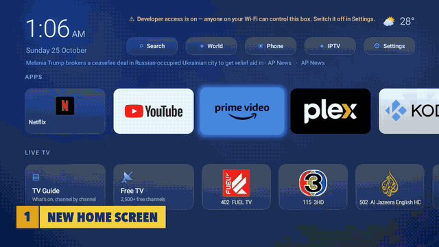

# Glow

A home screen and live TV app for cheap Android TV boxes. Glow turns a slow, cluttered "Ultra HD" box into
something that feels like a proper set-top box: a clean home screen, a classic blue satellite-style TV guide
with channel numbers, a player that keeps trying until a channel plays, a phone remote, and world headlines.

It was built for (and on) a TV98 box: Allwinner H616, 1 GB of RAM, Android 10. The whole app is 828 KB.



**[Watch the 28-second tour (MP4)](docs/glow-promo.mp4)** · [All screenshots](docs/screenshots) · [Measured results](docs/BENCHMARKS.md)

## What it does

- **Home screen**: clock, local weather, a rolling world headline, icon buttons (search, world, phone, IPTV,
  settings, and a red shield while developer access is on), your apps as full-colour cards, and live TV
  (guide, free channels, favourites) with channel numbers.
- **TV guide**: a numbered menu (All Channels, Favourites, Entertainment, Lifestyle & Culture, Movies, Sports,
  News, Documentaries, Kids, 0 More…), then channels against half-hour columns with a muted live preview.
  Type a number to jump; ◀ ▶ moves through the day; colour keys for Recently watched, Search, World and Favourites.
- **Channel numbers and ranking**: every channel gets a number in its genre's block (Entertainment 1xx,
  Lifestyle 2xx, Movies 3xx, Sports 4xx, News 5xx, Documentaries 6xx, Kids 7xx, Music 8xx). Inside each genre,
  hand-picked top channels come first (Red Bull TV, FUEL TV and the fight channels in Sports; Al Jazeera
  English, CNA, DW, France 24, NBC News NOW and ABC News Live in News), then English and Thai feeds before other
  languages, with regional copies and local stations below the main channel. Numbers are saved, so they don't move.
- **Player** (ExoPlayer): if a link is dead it tries the channel's other links, then the broadcaster's official
  stream, then its official YouTube live. Neighbouring channels are prepared in advance, so changing channel takes
  about 2 s. Last channel, digits, now/next banner.
- **Free TV**: about 2,300 working channels from the public [iptv-org](https://github.com/iptv-org/iptv) lists
  (Thailand, UK, US, world news, sports), link-checked every 12 hours so dead ones stay hidden.
- **Programme listings**: UK/US from [epg.pw](https://epg.pw)'s daily XMLTV files, Pluto TV channels from their own
  schedules ([i.mjh.nz](https://github.com/matthuisman/i.mjh.nz), matched on the Pluto id in the stream link), and
  Thai channels from TrueID, fetched when they scroll into view. Channel logos in the guide.
- **Phone remote**: open the box's address on your phone, enter the 4-digit code shown on the TV, then use a
  D-pad, type searches and logins, open favourites. Home network only; switches itself off after 30 minutes.
- **World**: top stories and alerts by region from [World Monitor](https://github.com/koala73/worldmonitor), with
  article pictures, a QR code to read the story on your phone, and OK to watch a news channel covering that region.
- **My IPTV**: sign in with your own Xtream-style provider details to browse and play their channels.
- **Settings**: switch developer access (ADB) off and on in two clicks, hide offline channels, refresh lists.

| | | |
|---|---|---|
|  |  |  |
|  |  |  |
|  |  |  |

## Measured on the box

| | Before | After |
|---|---|---|
| Loading the channel lists | 1,430 ms | 70 ms |
| Opening the TV guide | 3,198 ms | 147 ms |
| Changing channel (median of 20) | 2,395 ms | 1,984 ms |
| Giving up on a dead channel | ~27 s | 11 s |
| Top sports & news picks that play | — | 15 / 15 |
| Glow's memory on Home | — | 42 MB |

Every change has a before/after in [docs/BENCHMARKS.md](docs/BENCHMARKS.md), including what didn't work.

## Build

Glow builds with the plain Android SDK tools, no Gradle. On macOS:

```bash
brew install openjdk@17 android-commandlinetools python3
sdkmanager "build-tools;34.0.0" "platforms;android-35"
./build.sh
```

The first build downloads the player libraries (Media3 ExoPlayer 1.11.1 and its dependencies, pinned in
`tools/fetch_libs.sh`), generates `WmCatalog.java` from World Monitor's channel catalogue, and creates a signing
key (`glow.keystore`, kept out of git; set `GLOW_KS_PASS` to choose its password). The APK lands in `build/glow.apk`.

## Install on a box

1. On the box, turn on developer options and USB/network debugging. Many cheap boxes expose ADB on port 5555 or
   8888 once it's on.
2. From your computer:

```bash
export GLOW_DEVICE=192.168.1.50:5555   # your box's address and ADB port
adb connect $GLOW_DEVICE
tools/install.sh                       # installs and fully pre-compiles Glow
box/make-glow-home.sh $GLOW_DEVICE     # makes Glow the Home screen
box/debloat.sh $GLOW_DEVICE            # optional: switches off factory test apps, side-loaded stores and extras
```

`box/undo.sh` turns everything back on and restores the stock Home screen. Nothing is deleted.

3. **Switch developer access off when you're done** (Glow ▸ Settings ▸ Developer access). While it's on, anyone on
   your Wi-Fi can fully control the box; Glow shows a warning on Home until it's off.

## Channels and content

Glow doesn't host, bundle or sell any streams. It plays freely published streams from the public iptv-org lists
and broadcasters' own links and official YouTube channels. Pay-TV channels that only appear in those lists as
unofficial re-streams (ESPN, CNN, Fox News Channel, beIN Sports 1–8 and similar) are never promoted. Glow doesn't
get around any sign-in or subscription: My IPTV needs your own provider account. TLS certificate checks are never
switched off.

## Project layout

| Path | What's there |
|---|---|
| `src/com/tv98/glow/` | The app. `HomeActivity`, `ClassicGuideActivity` + `GuideGridView` (guide, drawn as one view), `GuideLineup` + `Genres` (numbers and ranking), `PlayerActivity` + `Sources` + `OfficialLive` (playback and fallbacks), `FreeTv` + `Health` (channel lists and link checks), `Guide` (listings), `Remote` (phone remote), `World`, `Weather` |
| `res/raw/remote.html` | The phone remote's web page |
| `tools/` | Build helpers, install, benchmarks (`bench.sh`, `zapbench.sh`, `guidebench.sh`, `scrollbench.sh`), a mock IPTV server for testing logins, the screenshot tour and video scripts |
| `box/` | Debloat, make-Home and undo scripts for the TV98 box |
| `docs/` | Screenshots, tour video, benchmarks |

## Credits

- [AndroidX Media3 / ExoPlayer](https://github.com/androidx/media) and [Guava](https://github.com/google/guava): Apache-2.0, downloaded at build time
- [QR Code generator](https://www.nayuki.io/page/qr-code-generator-library) by Project Nayuki: MIT, included in `src/io/nayuki/qrcodegen`
- [iptv-org/iptv](https://github.com/iptv-org/iptv): channel lists (Unlicense), fetched by the app
- [World Monitor](https://github.com/koala73/worldmonitor): headlines and the news-channel catalogue (AGPL-3.0); the catalogue is downloaded and turned into `WmCatalog.java` at build time and is not part of this repository
- [epg.pw](https://epg.pw), [i.mjh.nz](https://github.com/matthuisman/i.mjh.nz) (Pluto TV) and [TrueID](https://tv.trueid.net): programme listings, fetched by the app
- [Open-Meteo](https://open-meteo.com): weather (CC BY 4.0)

Built with [Claude Code](https://claude.com/claude-code).

## License

[MIT](LICENSE)
